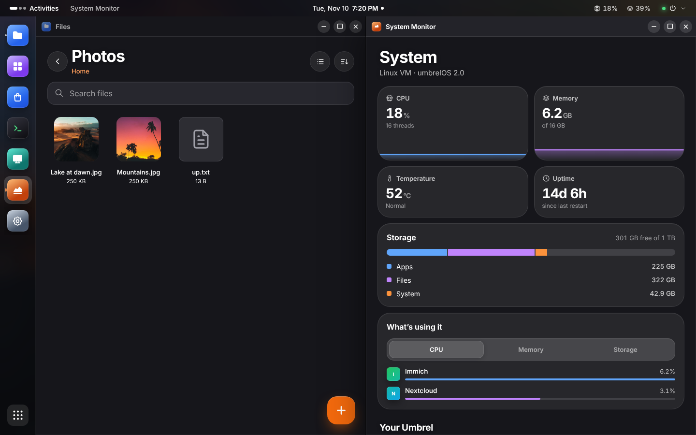
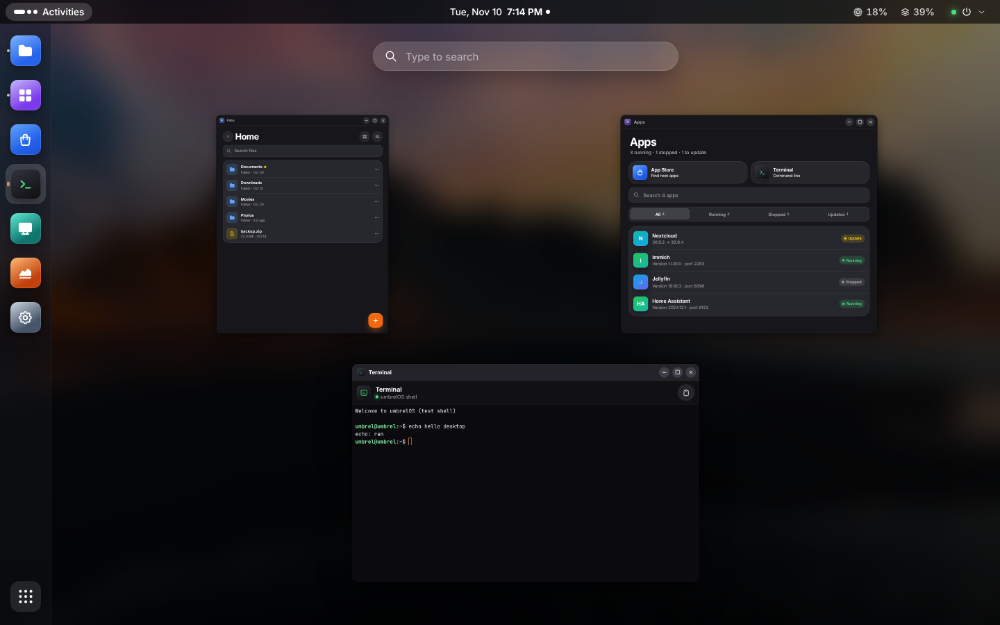
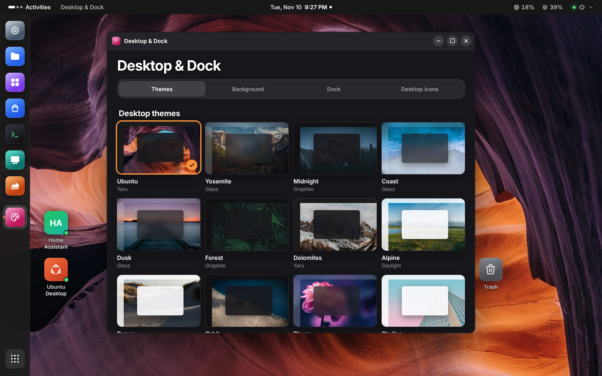
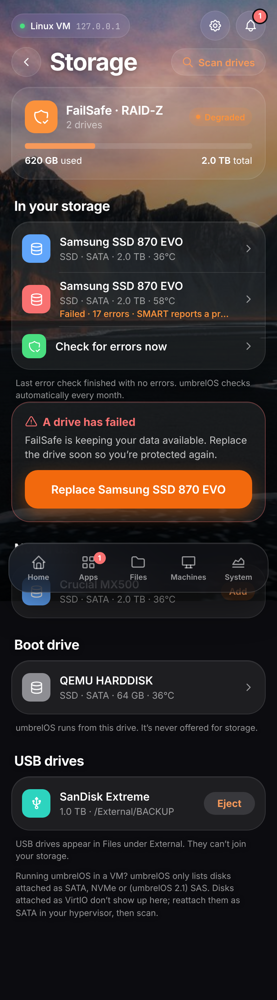

# UmbrelOS Touch

A phone-first interface for umbrelOS. It runs beside your Umbrel, signs in the same way Umbrel's own iPhone and Mac apps do, and controls your real apps, machines and system. It never modifies the Umbrel.

| Home | App actions | App Store | System | Settings | New machine |
| --- | --- | --- | --- | --- | --- |
|  |  |  |  |  |  |

## Look and feel

- **Your umbrelOS wallpaper.** It's loaded from your own Umbrel. The accent color matches the wallpaper's brand color, just like umbrelOS.
- **Frosted glass** cards, sheets and a floating dock with a sliding indicator.
- **Tabler icons**, the same open-source icon family umbrelOS uses. **Inter** is bundled locally, so nothing loads from a CDN.
- **Touch-first details:** bottom sheets you can swipe down to close, spring animations, a light vibration on Android, and tap targets of at least 44 px. It respects Reduce Motion.
- **Themes:** Horizon (your umbrelOS wallpaper), **Your photo** (upload any picture; the accent colour is picked from it), Midnight, Neon, Ember and Daylight, plus seven accent colours.
- **Settings → Appearance:** theme, accent and photo are saved on the Touch server per umbrelOS account, so every phone you sign in on looks the same.

## What works

- **Home**: live CPU, memory and storage rings, temperature and uptime, app updates, recently opened apps, and an app grid. Stopped apps are dimmed, apps with updates get a badge, and busy apps show a progress ring.
- **Apps**: search and filters. Tap an app to open it, start, stop, restart, update, view live logs, or uninstall (with confirmation). There is also *Update all*.
- **Files** (in the dock): your Umbrel as a NAS. See [Files](#files).
- **App Store** (a tile next to Terminal on Home and in Apps): featured apps with screenshots, a shelf for each category, and search. Get and Open buttons sit on every app. App pages show the version, category, size, gallery and description. Install is guided: it lists the folders and GPU access the app will get, and blocks the install until missing dependencies are installed.
- **Community app stores** (App Store → ⋯): add or remove stores by link, with a warning that they aren't reviewed by Umbrel. The [TouchWorkStation store](https://github.com/TouchWorkStation/umbrel-app-store) is one tap and adds Google Chrome and Brave browsers that run on your Umbrel and stream to any device.
- **Machines**: your VMs with their live state. **Create** a machine from umbrelOS's OS catalog (Ubuntu, Debian, Fedora, Alpine, Windows…) with per-OS starting specs for cores, memory and disk. Start, shut down, restart, force stop, delete (with confirmation), and a full-screen touch **console**.
- **Settings** (gear button): name, password, two-factor authentication, umbrelOS wallpaper, signed-in devices (sign out one or all others), software update with live progress and stable/beta channel, device name, IP address, Wi-Fi, Tor, public DNS, system logs, restart, shut down and factory reset (password + typing RESET). **Appearance** and **Storage** have their own pages (see [Storage](#storage)). Users, backups, static IP and app-store sources link to the umbrelOS dashboard.
- **System**: live CPU and memory charts, temperature, uptime, a storage breakdown, a ranked "what's using it" list for CPU, memory and storage, umbrelOS update status, and restart or shut down the Umbrel.
- **Notifications**: a bell with a count, and a sheet where you can dismiss each one.
- **PWA**: add it to your Home Screen to run full screen.
- **Desktop mode** on computers: windows, a dock and Activities, like Ubuntu. See [Desktop mode](#desktop-mode).

## How it connects (and why it's safe)

```
Phone ──(cookie)──> UmbrelOS Touch server ──(Bearer, native session)──> umbreld /trpc
```

- umbreld's browser login ties its token to an HttpOnly cookie on umbreld's own address and sends no CORS headers, so a separate web page can't call it directly. umbreld also has a **native login** (`user.loginNative`, added in umbrelOS 2.0) that issues a 1-hour access token plus a device token for renewing it. UmbrelOS Touch uses that.
- Those credentials stay on the Touch server, in a 0600 file. Your phone only gets an opaque `HttpOnly; SameSite=Strict` cookie.
- Each phone that signs in becomes its own session in umbrelOS. If you revoke it there, that phone is signed out.
- Only an **allowlist** of umbreld procedures can be reached (see `ALLOWED` in `server/app.mjs`). User management, static IP, backups, storage and app-store repositories are refused before they reach the Umbrel; password changes and factory reset are allowed but umbreld itself re-checks your password.
- Every action that changes something has to come from the app's own page (custom header plus Origin check). Sign-in is rate-limited.
- No Docker socket, no SSH, no changes to umbrelOS files.
- umbrelOS before 2.0 has no native login. For those versions it falls back to `user.login` bearer tokens.

## Install

**On your Umbrel (recommended).** Open umbrelOS, go to **Settings > Advanced settings > Terminal**, and paste:

```bash
curl -fsSL https://raw.githubusercontent.com/TouchWorkStation/Umbrelos/main/install.sh | sudo bash
```

It builds a small Docker image, starts one container named `umbrel-touch`, and prints the address to open on your phone (`http://<umbrel-ip>:7780`). Sign in with your umbrelOS password, then **Share > Add to Home Screen**.

- Nothing in umbrelOS is modified. The container talks to umbrelOS over `127.0.0.1`, the same API the dashboard uses.
- It restarts on boot. Docker's data lives on umbrelOS's data partition, so it is expected to survive umbrelOS updates.
- **Update:** run the same command again. **Remove:** add `-s -- uninstall` after `bash`.
- **Different port:** `... | sudo TOUCH_PORT=7790 bash`

**On another Linux machine with Docker** (a NAS, a Pi): the same command, with your Umbrel's address:

```bash
curl -fsSL https://raw.githubusercontent.com/TouchWorkStation/Umbrelos/main/install.sh | sudo UMBREL_URL=192.168.1.50 bash
```

**Windows:** install Node.js 20+ and double-click `start-windows.cmd`. **By hand:** `npm ci && npm run build && node server/cli.mjs --umbrel 192.168.1.50`.

## Desktop mode

On a computer, UmbrelOS Touch becomes a full desktop in the style of Ubuntu.



- **Windows** you can drag, resize from any edge or corner, minimize, maximize (double-click the title bar) and close. Drag a window to the top edge to maximize it, or to the left or right edge to fill half the screen.
- **Dock** on the left: Files, Apps, App Store, Terminal, Machines, System Monitor and Settings, plus any Umbrel apps you pin or have open. Dots show open windows. Click an app to open or focus it; click it again to minimize. Right-click for New window (Files, Terminal), Pin to dock, Open in a browser tab, or Close.
- **Umbrel apps open in windows.** Each app window has Reload and Open in a browser tab buttons.
- **Activities** (top left, or tap the Super key): every window side by side, plus search. Type to find any app and press Enter to open it. **Show Applications** (bottom of the dock) shows them all.
- **Top bar**: the active window's name, the clock with notifications and a calendar, live CPU and memory, and a system menu (Settings, System Monitor, switch to phone layout, sign out, restart, shut down).
- **Terminal and VM consoles** open as their own windows. **Ctrl+Alt+T** opens a terminal.
- **VM consoles work like a desktop VNC client**: your real mouse (left, right, middle, wheel) and keyboard go straight to the machine. The console toolbar has **Fit** (scale to the window), **100%** (every pixel, with scrollbars) and **Resize VM** (asks the machine to switch to the window's resolution, when its display supports that), a **Keys** menu for shortcuts your computer would otherwise catch (Ctrl+Alt+Delete, Alt+Tab, Super, Ctrl+Alt+F1…), **Type text** (sends pasted text as keystrokes), **Screenshot** and **Full screen**. In full screen the toolbar tucks away; move the mouse to the top edge to bring it back, and press Esc to leave. On HTTPS, Chrome also passes keys like Esc, Alt+Tab and the Windows key to the machine while in full screen (hold Esc to leave).
- **Desktop icons** for folders, Umbrel apps, machines and system apps. Double-click to open (a stopped machine starts and its console opens once it's running), drag to arrange (they snap to a grid), drag across the desktop to select several, Delete removes the selected shortcuts. Right-click the desktop to add icons, arrange them, change the background or open a terminal; right-click an icon to open, pin, remove or shut a machine down. Green dots show what's running. **Add all running apps and machines** fills the desktop in one click.
- **Customizable dock**: hover any icon for its name. Drag icons to reorder, drag one onto the desktop to add an icon there, right-click to pin or unpin. Put it on the left, bottom or right; small, medium or large; full-height panel or floating; auto-hide; show or hide open apps that aren't pinned.
- **Desktop themes and wallpapers**: twelve high-resolution photo wallpapers, twelve themes (Ubuntu, Yosemite, Midnight, Coast, Dusk, Forest, Dolomites, Alpine, Dunes, Orbit, Bloom, Skyline), four panel styles (Yaru, Glass, Graphite, Daylight) and an accent colour taken from the wallpaper or picked yourself. Or use your umbrelOS wallpaper or upload a photo. All of it is in **Desktop & Dock** (right-click the desktop, or the system menu).
- Your windows, dock, desktop icons and theme are remembered on this computer; your phone's look isn't changed.





Wallpaper credits and licences: [web/public/wallpapers/CREDITS.md](web/public/wallpapers/CREDITS.md) (CC0, Unsplash and Pexels licences, from the elementary OS collection).

**Settings → Appearance → Layout** picks the layout: *Automatic* uses the desktop on wide screens with a mouse or trackpad (phones and tablets stay on the touch layout), *Desktop* or *Phone* forces one. It's saved per device.

**Every app opens in a window.** When you sign in, umbrelOS's own login also issues its app session. Touch keeps it on the server, so apps open with no second sign-in. Each app is served through a small Touch relay at its own address: on your network that's a port of its own (7800 and up), and remotely it's a subdomain (see below). The relay:

- answers only browsers signed in to Touch, and never passes Touch's cookies to the app;
- still goes through umbrelOS's app gateway, so umbrelOS checks the session (and app sharing) on every request;
- replaces the app's "nobody may embed me" header (`X-Frame-Options`, CSP `frame-ancestors`) with "only this Touch page may embed me", so Forgejo, Nextcloud, Home Assistant and the rest open in windows while staying protected from other sites;
- passes WebSockets through.

Sessions from before 0.12 don't have the app session yet; sign out and back in once. Some apps build absolute links to their own port from their settings (for example a `ROOT_URL`); a click on one of those leaves the relay and gets blocked. Use the window's **Open in a browser tab** button for those. Apps that need HTTPS with their own certificate open in a tab. **Desktop & Dock → Desktop icons → Open apps in** can send every app to a browser tab.

### Remote access (Cloudflare tunnel)

Touch's sign-in asks for your umbrelOS **username and password** every time (plus your 2FA code if it's on). A wrong username and a wrong password get the same answer, account names aren't shown before sign-in, and there are at most 10 attempts per 5 minutes per address. umbrelOS's own rate limits and 2FA apply too.

Through a tunnel there's only one address, so app relays can't use their own ports. Give apps their own subdomains instead:

1. Pick a pattern with `{app}` in it, one level below your domain so Cloudflare's free certificate covers it, for example `{app}-touch.example.com`.
2. Install or update with it (it's saved, so later updates keep it; `TOUCH_APP_HOSTS=off` removes it):
   ```
   curl -fsSL https://raw.githubusercontent.com/TouchWorkStation/Umbrelos/main/install.sh | sudo TOUCH_APP_HOSTS='{app}-touch.example.com' bash
   ```
3. In the tunnel, route both `touch.example.com` and `*.example.com` (or just the app hostnames you use) to `http://localhost:7780`.

Opening an app then hands the window over to `forgejo-touch.example.com` with a one-time, two-minute ticket. That sets a cookie for that app's address only, valid 12 hours and only while your Touch session lives. Putting Cloudflare Access in front of `touch.example.com` and the app hostnames adds another lock, and works fine with Touch.

## Files

|  |  |
|---|---|

Files is in the dock and works through umbreld's own file API, so it sees what umbrelOS's Files app sees: Home, App data, external drives, network shares and Trash.

- **Browse**: places, recents, favorites, storage left, a list or grid view with photo thumbnails, sort by name, date or size, and search across all files.
- **Open**: tap a file to open it in a full-window viewer. Swipe (or use ← →) to step through the folder; the ⋯ button has share, save to phone, rename, move, copy, favorite and trash.
  - Photos with pinch and double-tap zoom (HEIC, TIFF and RAW show through umbrelOS's own preview renditions), video and music.
  - PDFs on every page with zoom, rendered by pdf.js so they look the same on iPhone, Android and desktop.
  - Word (.docx), Excel (.xlsx, with sheet tabs) and PowerPoint (.pptx) documents, Keynote, Pages and Numbers previews.
  - Text and code with line numbers, and Markdown rendered or as source. **Edit** text, Markdown and CSV files and **Save** them in place.
  - CSV and TSV as a spreadsheet; zip archives list their contents and **Extract** next to the archive (also .tar, .7z and .rar).
  - Fonts show a type specimen; anything else gets a card with Download.
- **Select**: long-press to select several items, then save them as a zip, move, copy or trash them.
- **Upload**: the Upload button (also on the Files start page, into Home) sends photos or files with progress; on a computer, **Upload folder** sends a whole folder with its subfolders, and you can drag files or folders straight onto the Files window. Name clashes keep both copies. Up to three files upload at once.
- **Download**: every file and folder has a download button (folders arrive as a zip); select several to download them together.
- **New folder** sits next to Upload.
- **Share on your network**: any folder can be shared over SMB. The sheet shows the `smb://` and Windows addresses, the username and (on tap) the password, and each one copies with a tap.
- **Trash**: restore, delete forever, or empty Trash (each asks first).

Downloads, previews and uploads stream through the Touch server using your existing umbrelOS session; the phone never holds an Umbrel token. Previews are served with a locked-down sandbox CSP so an uploaded HTML or SVG file can't run scripts. Documents are parsed in the browser and their HTML is sanitized; HTML files are shown as source, never rendered. Older binary Office files (.doc, .xls, .ppt) aren't supported, and Office documents are read-only for now.

## Storage

Settings → Storage shows every drive umbrelOS can see, through the same calls as umbrelOS's own Storage Manager.



- **Scan drives**: asks umbrelOS to list drives again (it reads them live) and reports how many it found, how many are new, and how many aren't in use. The page also refreshes every 15 seconds.
- **Drive health**: SMART status, temperature, SSD wear, model, serial and device path for each drive. Pool members also show their status and read, write and checksum errors.
- **RAID, when you have a storage pool**: add a drive, add a mirrored pair (HDD FailSafe), add SSD acceleration to hard drives, turn a single SSD into FailSafe, replace a failed drive, and run an error check, with live progress. Each step offers only what umbrelOS allows for your pool, names the drive that will be erased, and asks first.
- **Without a pool** (a single-drive Umbrel): extra drives are listed with their health, but they can't be combined. umbrelOS only creates pools during setup, so the page explains the path: back up, reinstall on a separate boot drive with the drives connected, choose them during setup, then restore.
- **USB drives**: listed with where they're mounted, plus Eject.

Touch never calls `hardware.raid.setup`. umbreld marks it as a development-only call, and on a running Umbrel it writes a RAID config that the next boot mounts as the data drive, which means an empty pool in place of your apps and data. The server's allowlist refuses it.

**In a VM:** umbrelOS only lists disks that report a SATA or NVMe connection (umbrelOS 2.1 adds SAS). VirtIO disks don't show up, so attach extra disks as SATA in your hypervisor.

## Terminal

**Terminal** sits next to **App Store** at the top of Apps and in the Home app grid. It opens a full-screen shell on your Umbrel, the same one as umbrelOS's Settings → Terminal. Every running app also has a **Terminal** button in its sheet that opens a shell inside that app's container. The bottom row has the keyboard button plus esc, tab, sticky ctrl/alt, ^C, arrows, `| ~ / -`, home and end; the button at the top right pastes (on plain `http://` the phone won't let a page read the clipboard, so it opens a box you long-press → Paste into, then send). When the keyboard is up, the terminal slides so the line you're typing on stays in view. The shell's size is fixed when it starts (umbreld has no resize), so rotating the phone rescales the text instead. Owner account only, like umbrelOS.

## VM console

Machines > a running machine > **Open console** shows the VM's screen full-screen. Input works like RustDesk, Microsoft Remote Desktop and RealVNC on phones. There are two modes, switched at the top right:

| | Touch mode (default) | Mouse mode (trackpad) |
| --- | --- | --- |
| Click | tap where you want | tap (clicks at the cursor) |
| Right-click | long-press, or two-finger tap | two-finger tap, or the **R** button |
| Drag | long-press, then drag | double-tap and hold, then drag (or hold **L**) |
| Move the pointer | — | drag one finger; the cursor follows with acceleration |
| Scroll | two-finger swipe | two-finger swipe |
| Zoom | pinch, or − / + (tap the % to fit) | same |
| Move around while zoomed | one-finger drag | the view follows the cursor |

The **keyboard** button at the bottom left opens the phone keyboard. Next to it, a key row has esc, tab, sticky ctrl/alt/shift, super, arrows, enter, backspace and ctrl+alt+del. A desktop mouse and trackpad also work (ctrl+scroll zooms).

umbreld only gives console tickets to browser sessions, not to the native sessions used for everything else. So at sign-in the Touch server also opens one browser-style session and keeps it server-side, used only to fetch a 30-second, single-use ticket each time a console opens. The VNC stream is then bridged phone <-> Touch server <-> umbreld. The bridge refuses connections from other sites and from signed-out phones.

## Develop

```bash
npm test                          # server tests against a test-only umbreld stand-in
node test/fake-umbreld.mjs 7781   # TEST ONLY fake, password "correct horse"
node server/cli.mjs --umbrel 127.0.0.1:7781 --data /tmp/touch &
npm run dev                       # Vite on :5173, proxies /api to :7780
```

The procedure names and data shapes come from getumbrel/umbrel at the umbrelOS 2.0 release (`9298257b`) and were checked against `master` (2.1 Beta 1).

## Not yet

- A dedicated Photos timeline (photos browse fine in Files).
- Compressing into archives, editing Office documents and PDFs, and connecting new network shares from other machines (use the umbrelOS dashboard).
- VM audio.
- Settings that change the system (users, Wi-Fi, backups). These are deliberately left out of the allowlist for now.

## License

UmbrelOS Touch's own code is MIT. It contains no umbrelOS source code. The file viewer uses pdf.js (Apache-2.0), mammoth (BSD-2-Clause), JSZip (MIT), marked (MIT) and DOMPurify (Apache-2.0). It talks to umbrelOS (PolyForm Noncommercial 1.0.0) over its API. Not affiliated with Umbrel.
