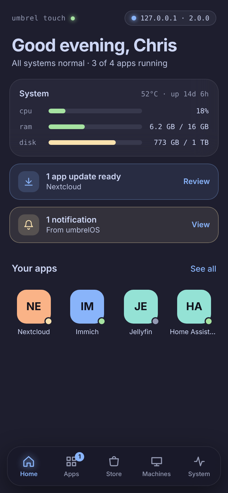
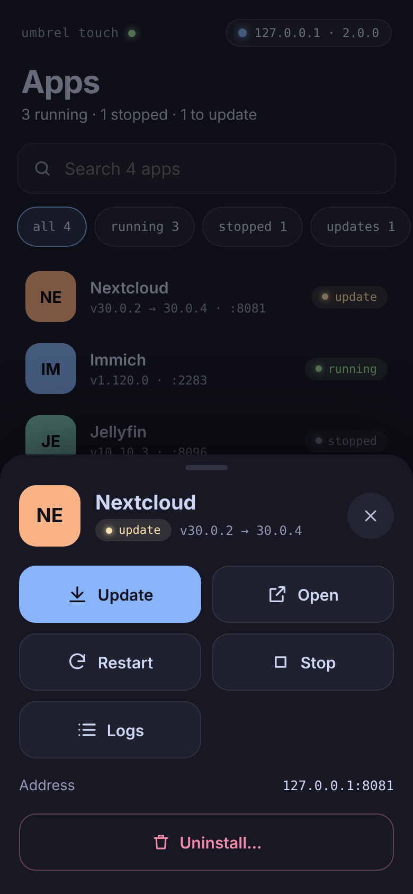
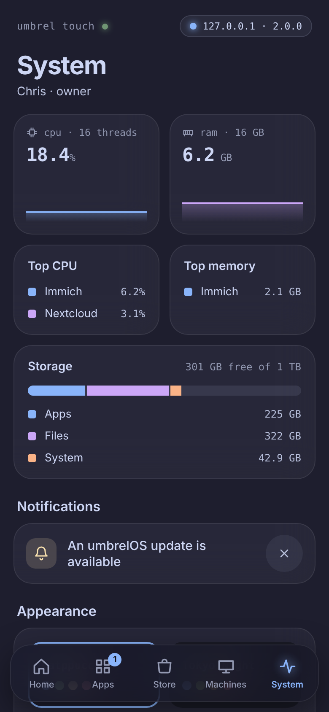

# UmbrelOS Touch

A phone-first interface for umbrelOS. It runs beside your Umbrel, signs in the same way Umbrel's own iPhone and Mac apps do, and controls your real apps, machines and system. It never modifies the Umbrel.

| Home | App actions | System |
| --- | --- | --- |
|  |  |  |

## What works

- **Home**: live CPU, RAM, disk and temperature, uptime, app updates, notifications, and an app grid with status badges.
- **Apps**: search and filters. Tap an app to open it, start, stop, restart, update, view live logs, or uninstall (with confirmation). There is also *Update all*.
- **App Store**: browse the full catalog from every store you've added, by category. App pages show the gallery and description. Install is guided: it lists the folders and GPU access the app will get, and blocks the install until missing dependencies are installed.
- **Machines**: your VMs with their live state. Start, shut down, restart, and force stop (with confirmation).
- **System**: live CPU and memory charts, the apps using the most CPU and memory, a storage breakdown, notifications, umbrelOS update status, and restart or shut down the Umbrel.
- **Themes**: Catppuccin, Tokyo Night, Gruvbox and Latte (light), with five accent colors. These are the same palettes as Takeout.
- **PWA**: add it to your Home Screen to run full screen. It works one-handed, tap targets are at least 44 px, and actions open in bottom sheets.

## How it connects (and why it's safe)

```
Phone ──(cookie)──> UmbrelOS Touch server ──(Bearer, native session)──> umbreld /trpc
```

- umbreld's browser login ties its token to an HttpOnly cookie on umbreld's own address and sends no CORS headers, so a separate web page can't call it directly. umbreld also has a **native login** (`user.loginNative`, added in umbrelOS 2.0) that issues a 1-hour access token plus a device token for renewing it. UmbrelOS Touch uses that.
- Those credentials stay on the Touch server, in a 0600 file. Your phone only gets an opaque `HttpOnly; SameSite=Strict` cookie.
- Each phone that signs in becomes its own session in umbrelOS. If you revoke it there, that phone is signed out.
- Only an **allowlist** of 34 umbreld procedures can be reached (see `ALLOWED` in `server/app.mjs`). Factory reset, password changes, network settings and app-store repositories are refused before they reach the Umbrel.
- Every action that changes something has to come from the app's own page (custom header plus Origin check). Sign-in is rate-limited.
- No Docker socket, no SSH, no changes to umbrelOS files.
- umbrelOS before 2.0 has no native login. For those versions it falls back to `user.login` bearer tokens.

## Run it

Run it on any always-on machine on the same network as the Umbrel. That could be the FygoNAS host, a Pi, or your PC. Don't run it inside the Umbrel VM.

**Docker** (simplest on a NAS):

```bash
docker compose up -d --build
```

**Linux, as a service:**

```bash
./install.sh 192.168.1.50      # your Umbrel's IP
```

**Windows:** install Node.js 20+ and double-click `start-windows.cmd`. Allow it on *Private networks* when Windows asks.

**By hand:**

```bash
npm ci && npm run build
node server/cli.mjs --umbrel 192.168.1.50   # --port 7780 by default
```

Then open `http://<that-machine>:7780` on your phone, sign in with your umbrelOS password, and choose **Share › Add to Home Screen**. If you didn't pass `--umbrel`, the app asks for the address on first launch.

## Develop

```bash
npm test                          # server tests against a test-only umbreld stand-in
node test/fake-umbreld.mjs 7781   # TEST ONLY fake, password "correct horse"
node server/cli.mjs --umbrel 127.0.0.1:7781 --data /tmp/touch &
npm run dev                       # Vite on :5173, proxies /api to :7780
```

The procedure names and data shapes come from getumbrel/umbrel at the umbrelOS 2.0 release (`9298257b`) and were checked against `master` (2.1 Beta 1).

## Not yet

- Files and Photos. umbreld serves these through separate `/api/files` endpoints, which haven't been wired in yet.
- VM console and the terminal. These need umbreld's one-time WebSocket tickets, and it hasn't been confirmed that native sessions get them. *Console in umbrelOS* opens the dashboard instead.
- Settings that change the system (users, Wi-Fi, backups). These are deliberately left out of the allowlist for now.

## License

UmbrelOS Touch's own code is MIT. It contains no umbrelOS source code. It talks to umbrelOS (PolyForm Noncommercial 1.0.0) over its API. Not affiliated with Umbrel.
