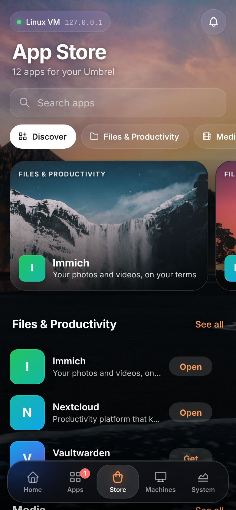
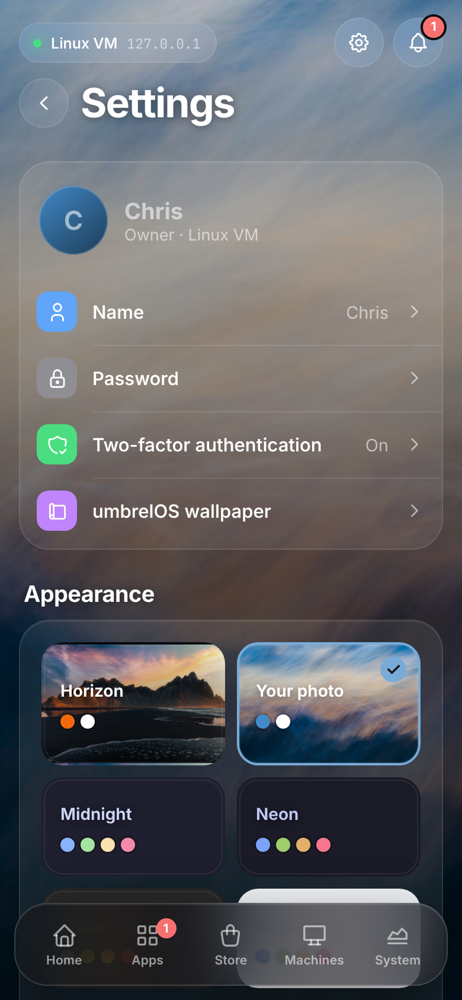
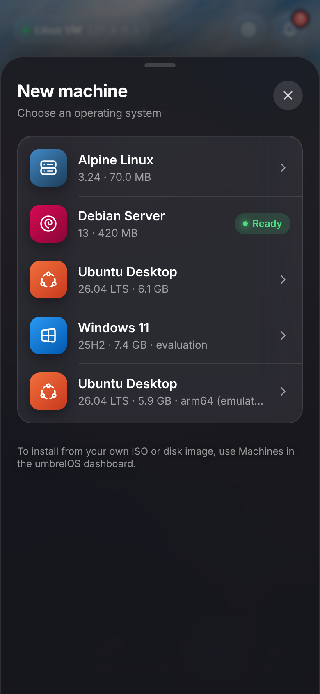
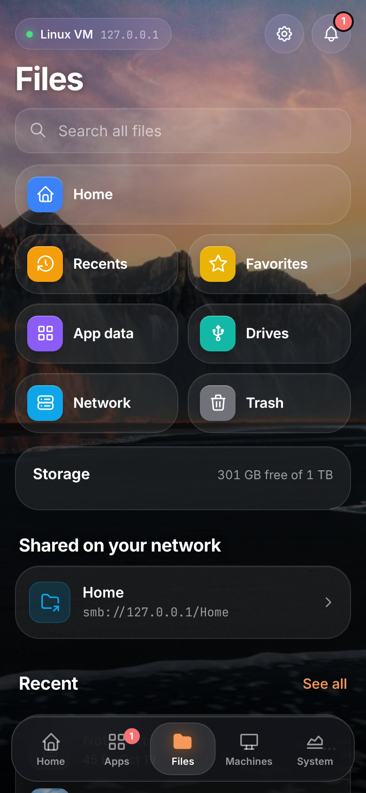
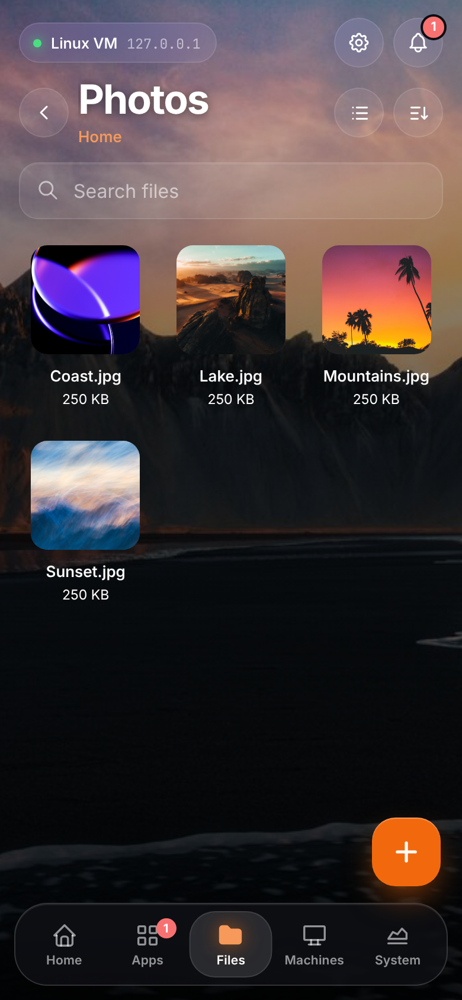

# UmbrelOS Touch

A phone-first interface for umbrelOS. It runs beside your Umbrel, signs in the same way Umbrel's own iPhone and Mac apps do, and controls your real apps, machines and system. It never modifies the Umbrel.

| Home | App actions | App Store | System | Settings | New machine |
| --- | --- | --- | --- | --- | --- |
|  |  |  |  |  |  |

## Look and feel

- **Your umbrelOS wallpaper.** It's loaded from your own Umbrel. The accent color matches the wallpaper's brand color, just like umbrelOS.
- **Frosted glass** cards, sheets and a floating dock with a sliding indicator.
- **Tabler icons**, the same open-source icon family umbrelOS uses. **Inter** is bundled locally, so nothing loads from a CDN.
- **Touch-first details:** bottom sheets you can swipe down to close, spring animations, a light vibration on Android, and tap targets of at least 44 px. It respects Reduce Motion.
- **Themes:** Horizon (your umbrelOS wallpaper), **Your photo** (upload any picture; the accent colour is picked from it), Midnight, Neon, Ember and Daylight, plus seven accent colours.
- **Saved appearance:** theme, accent and photo are saved on the Touch server per umbrelOS account, so every phone you sign in on looks the same.

## What works

- **Home**: live CPU, memory and storage rings, temperature and uptime, app updates, recently opened apps, and an app grid. Stopped apps are dimmed, apps with updates get a badge, and busy apps show a progress ring.
- **Apps**: search and filters. Tap an app to open it, start, stop, restart, update, view live logs, or uninstall (with confirmation). There is also *Update all*.
- **Files** (in the dock): your Umbrel as a NAS. See [Files](#files).
- **App Store** (a tile next to Terminal on Home and in Apps): featured apps with screenshots, a shelf for each category, and search. Get and Open buttons sit on every app. App pages show the version, category, size, gallery and description. Install is guided: it lists the folders and GPU access the app will get, and blocks the install until missing dependencies are installed.
- **Machines**: your VMs with their live state. **Create** a machine from umbrelOS's OS catalog (Ubuntu, Debian, Fedora, Alpine, Windows…) with per-OS starting specs for cores, memory and disk. Start, shut down, restart, force stop, delete (with confirmation), and a full-screen touch **console**.
- **Settings** (gear button): name, password, two-factor authentication, umbrelOS wallpaper, signed-in devices (sign out one or all others), software update with live progress and stable/beta channel, device name, IP address, Wi-Fi, Tor, public DNS, system logs, restart, shut down and factory reset (password + typing RESET). Users, backups, storage, static IP and app-store sources link to the umbrelOS dashboard.
- **System**: live CPU and memory charts, temperature, uptime, a storage breakdown, a ranked "what's using it" list for CPU, memory and storage, umbrelOS update status, and restart or shut down the Umbrel.
- **Notifications**: a bell with a count, and a sheet where you can dismiss each one.
- **PWA**: add it to your Home Screen to run full screen.

## How it connects (and why it's safe)

```
Phone ──(cookie)──> UmbrelOS Touch server ──(Bearer, native session)──> umbreld /trpc
```

- umbreld's browser login ties its token to an HttpOnly cookie on umbreld's own address and sends no CORS headers, so a separate web page can't call it directly. umbreld also has a **native login** (`user.loginNative`, added in umbrelOS 2.0) that issues a 1-hour access token plus a device token for renewing it. UmbrelOS Touch uses that.
- Those credentials stay on the Touch server, in a 0600 file. Your phone only gets an opaque `HttpOnly; SameSite=Strict` cookie.
- Each phone that signs in becomes its own session in umbrelOS. If you revoke it there, that phone is signed out.
- Only an **allowlist** of umbreld procedures can be reached (see `ALLOWED` in `server/app.mjs`). User management, static IP, backups, storage and app-store repositories are refused before they reach the Umbrel; password changes and factory reset are allowed but umbreld itself re-checks your password.
- Every action that changes something has to come from the app's own page (custom header plus Origin check). Sign-in is rate-limited.
- No Docker socket, no SSH, no changes to umbrelOS files.
- umbrelOS before 2.0 has no native login. For those versions it falls back to `user.login` bearer tokens.

## Install

**On your Umbrel (recommended).** Open umbrelOS, go to **Settings > Advanced settings > Terminal**, and paste:

```bash
curl -fsSL https://raw.githubusercontent.com/TouchWorkStation/Umbrelos/main/install.sh | sudo bash
```

It builds a small Docker image, starts one container named `umbrel-touch`, and prints the address to open on your phone (`http://<umbrel-ip>:7780`). Sign in with your umbrelOS password, then **Share > Add to Home Screen**.

- Nothing in umbrelOS is modified. The container talks to umbrelOS over `127.0.0.1`, the same API the dashboard uses.
- It restarts on boot. Docker's data lives on umbrelOS's data partition, so it is expected to survive umbrelOS updates.
- **Update:** run the same command again. **Remove:** add `-s -- uninstall` after `bash`.
- **Different port:** `... | sudo TOUCH_PORT=7790 bash`

**On another Linux machine with Docker** (a NAS, a Pi): the same command, with your Umbrel's address:

```bash
curl -fsSL https://raw.githubusercontent.com/TouchWorkStation/Umbrelos/main/install.sh | sudo UMBREL_URL=192.168.1.50 bash
```

**Windows:** install Node.js 20+ and double-click `start-windows.cmd`. **By hand:** `npm ci && npm run build && node server/cli.mjs --umbrel 192.168.1.50`.

## Files

|  |  |
|---|---|

Files is in the dock and works through umbreld's own file API, so it sees what umbrelOS's Files app sees: Home, App data, external drives, network shares and Trash.

- **Browse**: places, recents, favorites, storage left, a list or grid view with photo thumbnails, sort by name, date or size, and search across all files.
- **Open**: tap a file to preview it (photos full screen, video, audio, PDF, text). From there you can share it to other phone apps, save it to the phone, rename, move, copy, favorite or trash it.
- **Select**: long-press to select several items, then save them as a zip, move, copy or trash them.
- **Add**: the + button uploads photos or files with progress (name clashes keep both) or makes a new folder.
- **Share on your network**: any folder can be shared over SMB. The sheet shows the `smb://` and Windows addresses, the username and (on tap) the password, and each one copies with a tap.
- **Trash**: restore, delete forever, or empty Trash (each asks first).

Downloads, previews and uploads stream through the Touch server using your existing umbrelOS session; the phone never holds an Umbrel token. Previews are served with a locked-down sandbox CSP so an uploaded HTML or SVG file can't run scripts.

## Terminal

**Terminal** sits next to **App Store** at the top of Apps and in the Home app grid. It opens a full-screen shell on your Umbrel, the same one as umbrelOS's Settings → Terminal. Every running app also has a **Terminal** button in its sheet that opens a shell inside that app's container. The bottom row has the keyboard button plus esc, tab, sticky ctrl/alt, ^C, arrows, `| ~ / -`, home and end; the button at the top right pastes. The shell's size is fixed when it starts (umbreld has no resize), so rotating the phone rescales the text instead. Owner account only, like umbrelOS.

## VM console

Machines > a running machine > **Open console** shows the VM's screen full-screen. Input works like RustDesk, Microsoft Remote Desktop and RealVNC on phones. There are two modes, switched at the top right:

| | Touch mode (default) | Mouse mode (trackpad) |
| --- | --- | --- |
| Click | tap where you want | tap (clicks at the cursor) |
| Right-click | long-press, or two-finger tap | two-finger tap, or the **R** button |
| Drag | long-press, then drag | double-tap and hold, then drag (or hold **L**) |
| Move the pointer | — | drag one finger; the cursor follows with acceleration |
| Scroll | two-finger swipe | two-finger swipe |
| Zoom | pinch, or − / + (tap the % to fit) | same |
| Move around while zoomed | one-finger drag | the view follows the cursor |

The **keyboard** button at the bottom left opens the phone keyboard. Next to it, a key row has esc, tab, sticky ctrl/alt/shift, super, arrows, enter, backspace and ctrl+alt+del. A desktop mouse and trackpad also work (ctrl+scroll zooms).

umbreld only gives console tickets to browser sessions, not to the native sessions used for everything else. So at sign-in the Touch server also opens one browser-style session and keeps it server-side, used only to fetch a 30-second, single-use ticket each time a console opens. The VNC stream is then bridged phone <-> Touch server <-> umbreld. The bridge refuses connections from other sites and from signed-out phones.

## Develop

```bash
npm test                          # server tests against a test-only umbreld stand-in
node test/fake-umbreld.mjs 7781   # TEST ONLY fake, password "correct horse"
node server/cli.mjs --umbrel 127.0.0.1:7781 --data /tmp/touch &
npm run dev                       # Vite on :5173, proxies /api to :7780
```

The procedure names and data shapes come from getumbrel/umbrel at the umbrelOS 2.0 release (`9298257b`) and were checked against `master` (2.1 Beta 1).

## Not yet

- A dedicated Photos timeline (photos browse fine in Files).
- Archive extract/compress, and connecting new network shares from other machines (use the umbrelOS dashboard).
- VM audio.
- Settings that change the system (users, Wi-Fi, backups). These are deliberately left out of the allowlist for now.

## License

UmbrelOS Touch's own code is MIT. It contains no umbrelOS source code. It talks to umbrelOS (PolyForm Noncommercial 1.0.0) over its API. Not affiliated with Umbrel.
